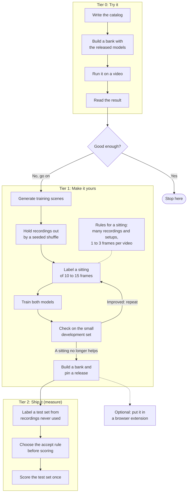
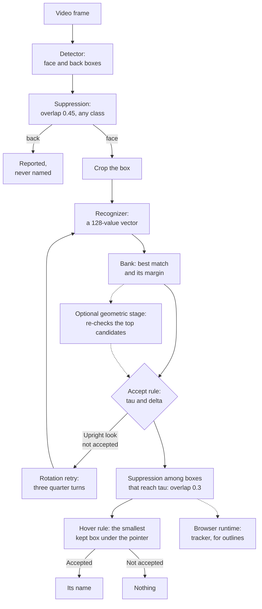

<!-- SPDX-License-Identifier: Apache-2.0 -->

# The whole process at a glance

Two pictures for a newcomer. One shows what you do, from a folder of card images to numbers
you can state. The other shows what the software does with each video frame. The detail is in
the [adapt guide](adapt-your-game.md) and in [how it works](how-it-works.md); this page links
to both and adds nothing they do not say.

## What you do

**How to read it.** Boxes are steps, the diamond is a decision, and a dashed line is optional
or a note. One loop repeats: label, train, check. Everything else happens once per pass
through the guide, and the test set is scored once.

1. **Tier 0: Try it.** Write the catalog: every card's id, name, kind and image file. Build a
   bank from your card images with the released recognizer, run the released models on a
   video, and read what they named. It needs a laptop and no GPU.
2. **Good enough?** If the cards you care about are named, stop. If not, tier 1 is the way
   forward.
3. **Tier 1: Make it yours.** Generate training scenes from your card images. Before you
   train, decide which recordings are for training and which are for measuring, by recording
   group and by a seeded shuffle: a recording you train on can never measure anything again.
4. **The labeling loop** (repeats). Label a sitting of about 10 to 15 frames, train both
   models, and check them on a small development set: a few frames from recordings you do
   not train on. If the check improved, label another sitting and train again.
   - Spread each sitting over as many different recordings and setups (clients, cameras,
     tables, lighting) as you can.
   - Typically take 1 to 3 frames from a video rather than many frames from one: more videos
     give more variety of lighting, angle and table. This is a practical rule, not a measured
     result.
   - Stop when a sitting no longer helps.
5. **Build a bank and pin a release.** A release is one document that pins the two models,
   the bank, the catalog and the accept rule together by hash.
6. **Optional: a browser extension.** The example extension Kenbunshoku has a guide,
   [Make it yours: an extension for another card game](https://github.com/ryangswe/kenbunshoku/blob/main/docs/make-it-yours.md),
   summed up in the [adapt guide](adapt-your-game.md#9-put-it-in-a-browser-extension-optional).
7. **Tier 2: Ship it** (happens once per decision). Label a separate test set from
   recordings never used for training or development. Calibrate the accept rule (`tau`,
   `delta`) on other recordings, and settle it before you score. Then score the test set
   once with the values you chose, and report those figures. A set you score every week
   becomes a set you tune to.

## How it works

**How to read it.** Two models do the work and two rules decide what is said. A dashed line
is optional or belongs to one runtime.

1. **The frame** is brought to a width between 720 and 1920 pixels.
2. **The detector** (YOLOX-Nano) finds boxes of two classes: **face**, a card lying face up,
   and **back**, a card lying face down. Overlapping boxes are thinned by greedy suppression
   at an overlap (IoU) of 0.45, whatever their class. A back is reported and never named.
   Boxes under 24 pixels are dropped.
3. **The crop.** Each face box is cut out of the frame and pooled to a 128 × 128 grid.
4. **The recognizer** turns the crop into a 128-value vector. It knows nothing about any list
   of cards.
5. **The bank** holds one vector per card, computed from card images: the mean of the
   recognizer's vectors for 16 views of the image (the image itself and 15 copies damaged as
   video damages a card). The crop's vector is compared with every row: the **score** is the
   highest similarity, and the **margin** is the score minus the best similarity among rows of
   a different identity. To add a card you add a row to the bank; no model is retrained.
6. **The accept rule.** A look is accepted when its score is at least `tau` and its margin is
   at least `delta`. An accepted look names its card; otherwise the result is nothing.
   Saying nothing is a normal result: a wrong name is treated as worse than a missing one.
7. **The rotation retry.** The upright look is tried, and when it is accepted the turned
   looks are never computed. Otherwise the three quarter turns are computed and all four
   compete.
8. **The optional geometric stage** is off unless you ask for it. It matches keypoints of the
   crop with those of the recognizer's top candidates, fuses the result with the cosine, and
   sends the fused scores through the same accept rule.
9. **The second suppression.** The face boxes whose look reaches `tau` take part in the hover
   rule. They are visited by score, highest first, and a box is kept unless it overlaps a kept
   box by an IoU of 0.3 or more. This is the `accepted-nms` selection a release names.
10. **The hover rule** decides which box the pointer is on: among the kept boxes, the topmost
    one that contains the point, with the smallest box on top. It shows that box's name if
    its look is accepted, and nothing otherwise. A kept box that fails the margin still takes
    the pointer, so a doubtful card on top hides the card beneath it.
11. **The tracker** is in the browser runtime only. It follows the kept boxes from frame to
    frame and names a track from the mean of its last five vectors, for steady outlines. A
    tooltip answers from the current frame and never waits for it. The Python tools analyze
    each frame on its own.

Every step names its module in [how it works](how-it-works.md).
